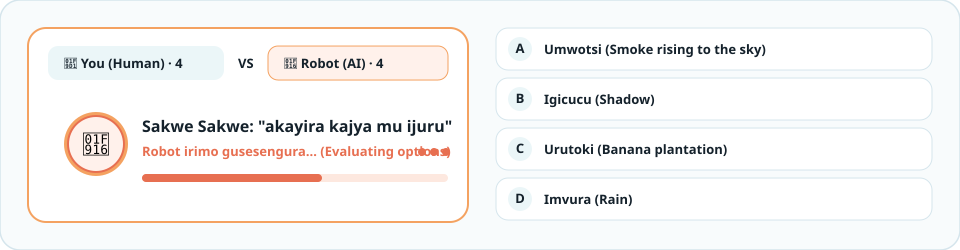
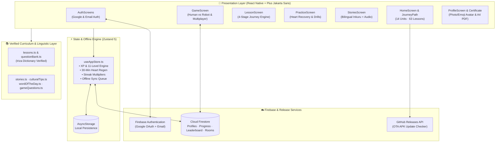

<div align="center">



<br />

[](https://github.com/Rulindana/menya-app/releases)
[](https://expo.dev)
[](https://reactnative.dev)
[](https://www.typescriptlang.org)
[](https://firebase.google.com)
[](./scripts/validateKinyarwanda.js)
[](./scripts/verifyAll.js)

<p align="center">
  <strong>Menya Ikinyarwanda 🇷🇼</strong> is a modern, gamified mobile and web learning platform for mastering the <strong>Kinyarwanda language</strong> and discovering Rwandan cultural heritage through a guided 4-stage pedagogical journey, bilingual stories, and traditional <em>Ibisakuzo</em> riddle battles.
</p>

<p align="center">
  <a href="https://github.com/Rulindana/menya-app/releases"><strong>📲 Download Latest Android APK</strong></a> ·
  <a href="#-4-stage-pedagogical-learning-journey"><strong>🧭 Learning Journey</strong></a> ·
  <a href="#-human-vs-robot-ibisakuzo-quiz-engine"><strong>🤖 AI Riddle Battles</strong></a> ·
  <a href="#-quick-start-for-contributors"><strong>🚀 Contributor Setup</strong></a> ·
  <a href="./CONTRIBUTING.md"><strong>🤝 Contributing Guide</strong></a>
</p>

</div>

---

## ✨ Why Menya?

Most language apps treat vocabulary as isolated flashcards. **Menya** is purpose-built around authentic **Kinyarwanda** pedagogy and Rwandan cultural expression:

- **14 Themed Units & 63 Authored Lessons**: Progress from greetings (*Muraho, Amakuru*) and family kinship to markets, numbers, Rwandan proverbs (*Imigani*), and conversational fluency.
- **100% Iriza Dictionary Verified**: Every Kinyarwanda headword, phrase, and dynamic word pair is automatically verified against the **Iriza Kinyarwanda Dictionary** via [`scripts/validateKinyarwanda.js`](./scripts/validateKinyarwanda.js).
- **Duolingo-Inspired 4-Stage Lesson Progression**: Learners never jump straight into cold tests—every lesson guides you through **Learn → Practice → Reinforce → Assessment**.
- **Cultural Immersion**: Includes bilingual **Rwandan Stories (*Inkuru*)**, unit-level **Cultural Etiquette Tips**, **Daily Challenges**, and traditional **Ibisakuzo (Sakwe Sakwe! — Soma!)** riddle battles.

---

## 🧭 4-Stage Pedagogical Learning Journey

Every lesson session in [`LessonScreen.tsx`](./src/screens/LessonScreen.tsx) is structured as an intentional four-stage sequence with a live stage stepper, animated transitions, and tactile haptic feedback:

<div align="center">
  
</div>

| Stage | Kinyarwanda Name | Pedagogical Role | Interactive Mechanics |
| :--- | :--- | :--- | :--- |
| **1. Learn** | *Intambwe ya 1: Kwiga* | Introduce core vocabulary & pronunciation | Interactive flip/audio cards, phonetic breakdown, cultural tips |
| **2. Practice** | *Intambwe ya 2: Kwitoza* | Low-stakes recognition & guided recall | Multiple-choice & fill-in-the-blank with spring-animated option cards |
| **3. Reinforce** | *Intambwe ya 3: Gushimangira* | Active production & contextual synthesis | Sentence-building word tiles & dynamic reinforcement from `questionBank.ts` |
| **4. Assessment** | *Intambwe ya 4: Isuzuma* | Mastery verification & progression unlock | Graded mastery check awarding XP, streak multipliers & perfect-lesson bonuses |

---

## 🤖 Human vs Robot: *Ibisakuzo* Quiz Engine

In [`GameScreen.tsx`](./src/screens/GameScreen.tsx), learners test their wits in **Ibisakuzo** (traditional Rwandan riddles) and vocabulary matches across three modes: **Human vs Robot (AI)**, **Pass & Play (2 Players)**, and **Live Room Code Multiplayer**.

<div align="center">
  
</div>

### Animated AI Opponent Features
- **Animated Robot Thinking Stage**: When it is the Robot's turn, an animated Robot avatar bobs and tilts while radiating a pulsing halo ring.
- **Progressive Bilingual Status & Bouncing Dots**: Displays real-time Kinyarwanda/English status prompts (*"Robot irimo gusoma ikibazo..."* → *"Robot irimo gusesengura..."* → *"Robot igiye gusubiza!"*) with staggered bouncing dots and a smooth thinking progress bar.
- **Live Option Scanning**: Watch the Robot visually scan across options **A, B, C, D** before locking in its answer.

---

## 🌟 Core Features at a Glance

| Feature Area | Highlights | Key Files |
| :--- | :--- | :--- |
| **Winding Learning Path** | Duolingo-style sectioned unit banners, winding lesson nodes, trophy milestones & certificate node | [`JourneyPath.tsx`](./src/components/journey/JourneyPath.tsx), [`HomeScreen.tsx`](./src/screens/HomeScreen.tsx) |
| **Interactive Option Cards** | Spring-physics press scaling, selection rings, correct bounce, and error shake animations | [`InteractiveOptionCard.tsx`](./src/components/ui/InteractiveOptionCard.tsx) |
| **Bilingual Stories (*Inkuru*)** | Line-by-line Kinyarwanda/English toggle, tap-to-speak TTS audio, vocabulary glossary & comprehension quiz | [`StoriesScreen.tsx`](./src/screens/StoriesScreen.tsx), [`stories.ts`](./src/data/stories.ts) |
| **Custom Photo & Emoji Avatars** | Pick a photo from Camera/Gallery or select from 16 Rwandan & quick emoji avatars synced across all screens | [`AvatarPicker.tsx`](./src/components/AvatarPicker.tsx), [`ProfileScreen.tsx`](./src/screens/ProfileScreen.tsx) |
| **Google & Email Auth** | One-tap **Continue with Google** (`@react-native-google-signin/google-signin` + Web Popup) & Email/Password | [`AuthScreens.tsx`](./src/screens/AuthScreens.tsx), [`config.ts`](./src/firebase/config.ts) |
| **Offline-First Sync Queue** | Local persistence via `AsyncStorage` + queued mutation replay (`pendingSyncQueue`) to Cloud Firestore | [`useAppStore.ts`](./src/store/useAppStore.ts), [`syncService.ts`](./src/firebase/syncService.ts) |
| **A4 Printable Certificate** | Earned upon completing all 63 lessons; exports portrait A4 PDF with QR verification scanner | [`CertificateScreen.tsx`](./src/screens/CertificateScreen.tsx), [`QRScannerScreen.tsx`](./src/screens/QRScannerScreen.tsx) |
| **In-App APK Auto-Updater** | Checks GitHub Releases (`Rulindana/menya-app`) on app launch and prompts users when a new APK is available | [`appUpdate.ts`](./src/services/appUpdate.ts), [`UpdateModal.tsx`](./src/components/UpdateModal.tsx) |

---

## 🏗️ System Architecture



---

## 🛠️ Tech Stack

| Layer | Technology | Version | Purpose |
| :--- | :--- | :--- | :--- |
| **Framework** | Expo + React Native | SDK `58.0` / RN `0.88` | Cross-platform Android, iOS & Web runtime |
| **Language** | TypeScript | `6.0` | End-to-end static typing |
| **Typography** | `@expo-google-fonts/plus-jakarta-sans` | `0.4.2` | Modern geometric typography system (`typography.ts`) |
| **Navigation** | React Navigation v7 | `7.x` | Native Stack & Bottom Tab navigation |
| **State Management** | Zustand + AsyncStorage | `5.0.15` | Reactive global state, local persistence & offline queue |
| **Backend & Auth** | Firebase (Auth + Firestore) | `12.18.0` | Google Sign-In, Email Auth, cloud sync, leaderboards & live rooms |
| **Audio & Haptics** | `expo-speech` + `expo-haptics` | `58.0` | Pronunciation synthesis & tactile feedback |
| **Icons & Graphics** | `lucide-react-native` + `react-native-svg` | `1.61.0` | Crisp vector iconography & custom SVG mascots |

---

## 🚀 Quick Start for Contributors

Menya is configured so contributors can clone and run the project immediately **without needing private signing keys or custom `.env` files**.

### 1. Clone & Install
```bash
git clone https://github.com/Rulindana/menya-app.git
cd menya-app
npm install
```

### 2. Run the Automated Verification Suite
```bash
npm test
```
This runs [`scripts/verifyAll.js`](./scripts/verifyAll.js), executing **3 verification suites (20 tests)**:
- **Suite 1**: Store state transitions, XP/level boundaries, heart regeneration, avatar switching & offline sync queue.
- **Suite 2**: 4-stage lesson journey construction (`learn → practice → reinforce → assessment`) across all 14 units.
- **Suite 3**: Iriza Kinyarwanda dictionary validation (`0` unverified words) & answer solvability across all exercises.

### 3. Start the Development Server
```bash
# Start Metro bundler (scan QR code with Expo Go or press 'a' for Android / 'w' for Web)
npm start

# Or launch directly on Android / Web:
npm run android
npm run web
```

See [**CONTRIBUTING.md**](./CONTRIBUTING.md) for detailed instructions on adding new Kinyarwanda lessons, stories, and riddles.

---

## 📦 Building the Android APK

You can build an installable Android `.apk` either in the cloud via **Expo EAS** or locally via **Gradle**:

### Option 1: Expo EAS Cloud APK Build
```bash
npm run build:apk:eas
# Equivalent to: npx eas-cli build --platform android --profile preview
```

### Option 2: Local Android Gradle APK Build
```bash
npm run build:apk:local
# Equivalent to: cd android && ./gradlew assembleRelease
```
- Output APK location: `android/app/build/outputs/apk/release/app-release.apk`
- *Contributor-friendly signing*: If no production keystore is configured via `MENYA_RELEASE_STORE_FILE`, [`android/app/build.gradle`](./android/app/build.gradle) automatically falls back to `debug.keystore` so local release builds work out-of-the-box on every machine.

---

## 🤝 Contributing

Contributions, Kinyarwanda linguistic improvements, new *Ibisakuzo* riddles, and UI enhancements are warmly welcomed! Please read our [**Contributing Guide (CONTRIBUTING.md)**](./CONTRIBUTING.md) and run `npm test` before submitting a pull request.

---

<div align="center">
  <strong>Made with ❤️ for Kinyarwanda learners worldwide · Menya Ikinyarwanda 🇷🇼</strong>
</div>
